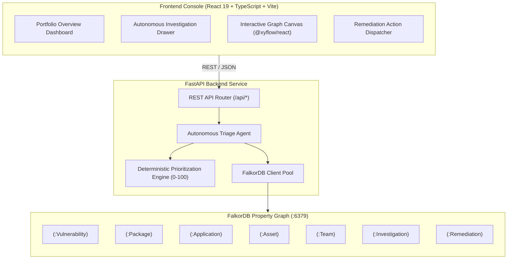
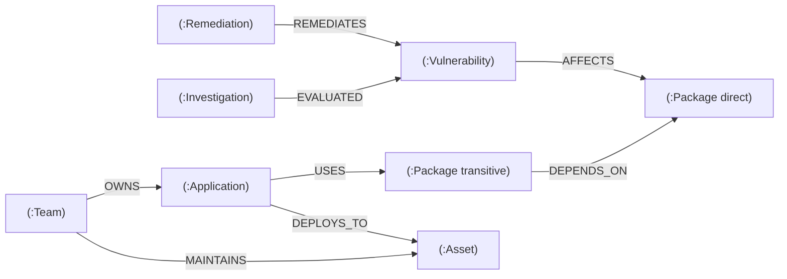

# 🛡️ PatchPilot — Graph-Powered Vulnerability Triage and Remediation Agent

> **WeMakeDevs Graph Hacks — Track 01: Agents That Act on Connected Data**  
> An autonomous security triage agent powered by **FalkorDB** property graphs, deterministic risk prioritization, and an evidence-backed remediation lifecycle.

[](https://python.org)
[](https://fastapi.tiangolo.com)
[](https://falkordb.com)
[](https://react.dev)
[](https://typescriptlang.org)
[](https://vitejs.dev)
[](LICENSE)

---

## 1. Project Title and High-Level Pitch

**PatchPilot** transforms enterprise vulnerability management by connecting isolated vulnerability findings to the full software supply chain and running cloud infrastructure.

Traditional vulnerability scanners overwhelm SecOps teams with flat lists of CVSS scores that lack runtime context. A CVSS 9.8 vulnerability in an isolated internal test sandbox triggers emergency alerts, while a CVSS 7.2 vulnerability actively reachable on an internet-facing payment cluster is deferred to the next sprint.

**PatchPilot solves this problem using connected graph data in FalkorDB**:
- Traverses multi-hop dependency chains from vulnerable packages to affected applications.
- Discovers running cloud infrastructure assets and evaluates their exposure (public vs internal) and business criticality.
- Identifies exact engineering code-owners and on-call escalation channels.
- Calculates a transparent, **deterministic 0–100 priority score** backed by traceable graph evidence.
- Proposes actionable, simulated remediation steps with a human-in-the-loop approval workflow.

---

## 2. Hackathon Context and Track Alignment

- **Hackathon**: WeMakeDevs Graph Hacks: Context for AI Agents
- **Selected Track**: **Track 01 — Agents That Act on Connected Data**
- **Core Technology**: **FalkorDB** (Low-latency graph database using Redis protocol & Cypher)

### How PatchPilot Fulfills Track 01 Requirements:
1. **Acting on Connected Data**: The PatchPilot agent does not simply visualize data; it executes Cypher traversals in FalkorDB to determine reachability, assess infrastructure blast radius, calculate priority, and propose remediation actions.
2. **Central Role for FalkorDB**: FalkorDB is the single source of truth for dependencies, assets, ownership, investigation records, and remediation status.
3. **No Hallucinated Evidence**: All risk evaluations cite real graph paths (`Package` $\rightarrow$ `Application` $\rightarrow$ `Asset` $\rightarrow$ `Team`).
4. **Deterministic & Explainable**: The agent combines Cypher traversals with a documented mathematical scoring model and optional LLM narrative synthesis.

---

## 3. Architecture Diagram and Explanation

PatchPilot is composed of three interconnected layers:



### Component Interaction:
1. **Web Console**: An accessible, warm light-themed UI built on React 19 and `@xyflow/react`.
2. **FastAPI Backend**: Validates inputs with Pydantic, orchestrates triage agents, executes Cypher queries, and handles degraded mode if the database is offline.
3. **FalkorDB Database**: Stores nodes and relationships, evaluates multi-hop dependency paths, and maintains investigation and remediation state.

---

## 4. FalkorDB Graph Model and Cypher Queries

### 4.1 Graph Schema & Directionality



> **Directionality Note**: When Package A depends on Package B, the relationship is stored as `(A)-[:DEPENDS_ON]->(B)`. Dependent discovery traverses incoming edges `(A)-[:DEPENDS_ON*]->(B)`.

### 4.2 Key Cypher Queries

#### Multi-Hop Blast Radius Discovery
Traverses direct and transitive packages up to 5 hops, identifying downstream applications, deployed assets, and responsible teams:
```cypher
MATCH (v:Vulnerability {id: $vuln_id})-[:AFFECTS]->(vuln_pkg:Package)
OPTIONAL MATCH (app:Application)-[:USES]->(direct_pkg:Package)
WHERE direct_pkg = vuln_pkg
OPTIONAL MATCH (app_trans:Application)-[:USES]->(dep_pkg:Package)-[:DEPENDS_ON*1..5]->(vuln_pkg)
WITH v, vuln_pkg,
     collect(DISTINCT app) + collect(DISTINCT app_trans) AS apps
UNWIND (CASE WHEN size(apps) = 0 THEN [null] ELSE apps END) AS app
OPTIONAL MATCH (app)-[:DEPLOYS_TO]->(asset:Asset)
OPTIONAL MATCH (team:Team)-[:OWNS]->(app)
RETURN v.id AS vuln_id,
       v.severity AS severity,
       vuln_pkg.name AS package_name,
       app.name AS application_name,
       asset.name AS asset_name,
       asset.criticality AS asset_criticality,
       asset.exposure AS asset_exposure,
       team.name AS team_name
```

#### Subgraph Node and Edge Extraction for UI Canvas
```cypher
MATCH (v:Vulnerability {id: $vuln_id})
OPTIONAL MATCH (v)-[r1:AFFECTS]->(p1:Package)
OPTIONAL MATCH (p2:Package)-[r2:DEPENDS_ON*1..5]->(p1)
OPTIONAL MATCH (app:Application)-[r3:USES]->(p)
WHERE p = p1 OR p = p2
OPTIONAL MATCH (app)-[r4:DEPLOYS_TO]->(asset:Asset)
OPTIONAL MATCH (team:Team)-[r5:OWNS]->(app)
RETURN v, p1, p2, app, asset, team, r1, r3, r4, r5
```

---

## 5. Agent Workflow and Prioritization Rules

### 5.1 Investigation Workflow
1. **Trigger**: User selects a vulnerability in the UI or invokes `POST /api/investigate`.
2. **Graph Expansion**: The agent queries FalkorDB to discover direct and transitive packages, downstream microservices, runtime hosts, and owner teams.
3. **Deterministic Scoring**: Calculates composite risk using the mathematical formula below.
4. **Explainable Rationale**: Generates step-by-step reasoning citing specific graph paths and exposure factors.
5. **Remediation Action**: Formulates a recommended remediation action (e.g. package upgrade, WAF rule, or host isolation).
6. **State Persistence**: Creates an `(:Investigation)` node linked via `[:EVALUATED]` to the vulnerability.

### 5.2 Deterministic Prioritization Formula

$$\text{Final Score} = \max\left(0, \min\left(100, S_{\text{sev}} + S_{\text{crit}} + S_{\text{reach}} + S_{\text{exp}} + P_{\text{conf}}\right)\right)$$

| Component | Weights & Rules | Max Contribution |
| :--- | :--- | :--- |
| **Vulnerability Severity ($S_{\text{sev}}$)** | CRITICAL: 40, HIGH: 30, MEDIUM: 18, LOW: 8, INFO: 2 | 40.0 pts |
| **Asset Criticality ($S_{\text{crit}}$)** | CRITICAL: 30, HIGH: 22, MEDIUM: 14, LOW: 6, None: 0 | 30.0 pts |
| **Reach Score ($S_{\text{reach}}$)** | $20.0 \times \frac{\ln(N_{\text{apps}} + 1)}{\ln(11)}$ (Logarithmic scaling based on affected apps) | 20.0 pts |
| **Exposure Bonus ($S_{\text{exp}}$)** | $+10.0$ if any affected asset has `exposure: "public"` | 10.0 pts |
| **Evidence Penalty ($P_{\text{conf}}$)** | $-15.0$ if evidence is flagged incomplete or unverified | -15.0 pts |

### Priority Bands & Action SLAs
- **CRITICAL (Score $\ge 75$)**: Immediate page to team on-call; 24-hour remediation SLA.
- **HIGH ($55 \le \text{Score} < 75$)**: Patch or mitigation within 7 days.
- **MEDIUM ($35 \le \text{Score} < 55$)**: Schedule in next planned sprint.
- **LOW ($\text{Score} < 35$)**: Routine dependency maintenance.
- **UNCERTAIN**: Incomplete evidence with score $< 40$; triggers manual verification prompt.

---

## 6. Distinctive Light UI Walkthrough

PatchPilot's user interface is purposefully designed with a **clean, accessible Light Theme** tailored for operational clarity:
- **Palette**: Warm ivory background (`#F8F7F2`), crisp white cards (`#FFFFFF`), charcoal typography (`#292D2A`), emerald accents (`#168568`), muted borders (`#E5E3DA`), and restrained alert badges.
- **No Dark Navy/Blue Backgrounds**: Avoids generic dark-dashboard fatigue.

```
+---------------------------------------------------------------------------------------+
|  PatchPilot 🛡️        [Overview]     [Investigate]     [Dependency Graph]  [Remediations]  |
+---------------------------------------------------------------------------------------+
|  ⚠️ SYNTHETIC BENCHMARK MODE: Deterministic ground-truth fixtures active               |
+---------------------------------------------------------------------------------------+
|  +--------------------+  +--------------------+  +--------------------+               |
|  | Total CVEs: 5      |  | Impacted Apps: 4   |  | Exposed Assets: 3  |               |
|  +--------------------+  +--------------------+  +--------------------+               |
|                                                                                       |
|  Vulnerability Queue                                                                  |
|  -----------------------------------------------------------------------------------  |
|  [CRITICAL] CVE-2021-44228  Log4Shell RCE               [SYNTHETIC]  [Investigate ➔]  |
|  [HIGH]     CVE-2022-22965  Spring4Shell                [SYNTHETIC]  [Investigate ➔]  |
|  [MEDIUM]   CVE-2023-3269   Node.js HTTP Smuggling      [SYNTHETIC]  [Investigate ➔]  |
+---------------------------------------------------------------------------------------+
```

### Key UI Views:
1. **Overview Dashboard**: High-level posture metrics, database health indicator, and vulnerability queue.
2. **Investigation Drawer**: Step-by-step agent execution timeline, priority factor score breakdown, and recommended action.
3. **Interactive Graph Canvas**: Visual node-link diagram powered by `@xyflow/react` showing the exact blast radius from CVE to infrastructure host.
4. **Remediation Management**: Lifecycle approval table allowing operators to review, approve, and track mitigation tasks.

---

## 7. Ground Truth Test Dataset and Expected Results

Stored in `data/synthetic_data/graph_dataset.json` and verified in `ground_truth_test_cases.json`:

| Test ID | Vulnerability | Severity | Dependency Depth | Expected Blast Radius | Ground Truth Priority | Notes |
| :--- | :--- | :--- | :--- | :--- | :--- | :--- |
| **TC-01** | `CVE-2021-44228` | CRITICAL | 2 hops (transitive) | `payment-service` $\rightarrow$ `prod-k8s-payment-cluster` (public, CRITICAL) | **CRITICAL (88.0)** | High CVSS, public production asset |
| **TC-02** | `CVE-2022-22965` | HIGH | 1 hop (direct) | `auth-service` $\rightarrow$ `prod-auth-vm` (internal, HIGH) | **HIGH (61.2)** | High severity, internal host |
| **TC-03** | `CVE-2023-3269` | MEDIUM | 1 hop (direct) | `internal-portal` $\rightarrow$ `staging-node` (internal, LOW) | **MEDIUM (40.0)** | Non-critical asset |
| **TC-04** | `CVE-2024-21626` | LOW | 1 hop (direct) | `analytics-worker` $\rightarrow$ `batch-runner` (isolated, LOW) | **LOW (28.0)** | Isolated worker node |
| **TC-05** | `VULN-INCOMPLETE-001` | HIGH | Unknown | No assets linked | **UNCERTAIN / LOW (15.0)** | Penalized -15.0 for missing evidence |

---

## 8. Prerequisites

- **Python**: 3.11, 3.12, 3.13, or 3.14
- **Node.js**: 18.x, 20.x, or 22.x
- **Docker**: Docker Engine 24+ or Docker Desktop (for running FalkorDB)

---

## 9. Quick Start Instructions

### Option A: Docker Compose (Recommended)

```bash
# 1. Clone repository
git clone https://github.com/sahilposwal35-wq/patchpilot.git
cd patchpilot

# 2. Setup environment template
cp .env.example .env

# 3. Launch FalkorDB and Backend
docker compose up -d

# 4. Start Frontend
cd frontend
npm install
npm run dev
```
Open **`http://localhost:5173`** in your browser.

---

### Option B: Native Development Setup

#### 1. Start FalkorDB
```bash
docker run -d --name patchpilot-db -p 127.0.0.1:6379:6379 falkordb/falkordb:latest
```

#### 2. Start Backend
```bash
cd backend
python3 -m venv venv
source venv/bin/activate
pip install -r requirements.txt
python ../scripts/seed_graph.py --clear
uvicorn app.main:app --reload --port 8000
```

#### 3. Start Frontend
```bash
cd ../frontend
npm install
npm run dev
```

---

## 10. Seeding and Re-seeding Instructions

To reload the synthetic benchmark dataset:

```bash
# CLI Seeder (idempotent MERGE)
python scripts/seed_graph.py

# CLI Seeder (wipe and reload clean)
python scripts/seed_graph.py --clear

# REST API endpoint
curl -X POST "http://localhost:8000/api/seed?clear_first=true"
```

---

## 11. Running Tests

```bash
cd backend
source venv/bin/activate

# Run full test suite
pytest -v

# Run deterministic scoring unit tests (zero database dependency)
pytest tests/test_prioritization.py -v
```

To test the frontend production build:
```bash
cd frontend
npm run build
```

---

## 12. Environment Configuration

Default `.env` configuration:

```bash
# FalkorDB Graph Database
FALKORDB_HOST=127.0.0.1
FALKORDB_PORT=6379
FALKORDB_PASSWORD=
FALKORDB_GRAPH=patchpilot

# Service Configuration
LOG_LEVEL=INFO
APP_HOST=127.0.0.1
APP_PORT=8000
CORS_ORIGINS=http://localhost:5173,http://localhost:3000

# AI Provider (deterministic local mode requires NO external keys)
LLM_PROVIDER=deterministic
OPENAI_API_KEY=
ANTHROPIC_API_KEY=
```

---

## 13. API Documentation Summary

| Method | Endpoint | Description |
| :--- | :--- | :--- |
| `GET` | `/api/health` | Health check (reports `ok` or `degraded` if DB is offline) |
| `GET` | `/api/overview` | Aggregated portfolio statistics |
| `GET` | `/api/vulnerabilities` | List all tracked vulnerabilities |
| `GET` | `/api/vulnerabilities/{id}` | Detailed vulnerability metadata |
| `POST` | `/api/investigate` | Trigger autonomous graph investigation |
| `GET` | `/api/investigations` | List historical investigation records |
| `GET` | `/api/graph/vulnerability/{id}`| Subgraph nodes & edges for UI canvas |
| `POST` | `/api/remediations` | Create simulated remediation action |
| `GET` | `/api/remediations` | List remediation records |
| `POST` | `/api/seed` | Seed or re-seed the FalkorDB dataset |

Full API specification available at [`docs/API.md`](docs/API.md) and interactive Swagger docs at `http://localhost:8000/docs`.

---

## 14. Security Considerations

- **Parameterized Cypher**: All queries utilize parameterized Cypher inputs to prevent injection.
- **Localhost Binding**: FalkorDB container port is bound strictly to `127.0.0.1:6379`.
- **Zero Secrets in Git**: Git tracking audited with strict ignore rules for keys, credentials, and virtualenvs.
- **Human-in-the-Loop Remediation**: Remediations are simulated lifecycle proposals requiring operator sign-off; no autonomous remote command execution.
- See [`docs/SECURITY.md`](docs/SECURITY.md) for full threat model.

---

## 15. Limitations and Future Work

- **Live SBOM Ingestion**: Future releases will integrate runtime CycloneDX / SPDX SBOM collectors.
- **Dynamic Reachability Tracing**: Integration with eBPF probes to detect in-memory function call execution of vulnerable classes.
- **Automated PR Dispatch**: Direct integration with GitHub Actions to open automated package upgrade pull requests upon operator approval.

---

## 16. Demonstration Walkthrough (3-Minute Script)

1. **Step 1: Inspect Threat Landscape (`OverviewPage`)**  
   Notice 5 vulnerabilities and 4 applications. Identify `CVE-2021-44228` (Log4Shell).
2. **Step 2: Trigger Autonomous Investigation (`InvestigatePage`)**  
   Click *Investigate*. Observe the agent expanding 2 hops from `log4j-core` to `spring-boot-starter-log4j2` to `payment-service`.
3. **Step 3: Review Evidence & Score**  
   Inspect the priority breakdown: Base severity (40 pts), Critical asset (30 pts), Reachability (8 pts), Public exposure (10 pts) = **88.0 (CRITICAL)**.
4. **Step 4: Explore Dependency Canvas (`GraphCanvas`)**  
   Interact with the visual graph nodes connecting the CVE to the `Payments Core Team`.
5. **Step 5: Approve Remediation (`RemediationHistory`)**  
   Select *Approve Package Upgrade (2.17.1)*. Confirm that the action is recorded in FalkorDB and assigned to on-call.

---

## 17. Repository Structure

```
patchpilot/
├── backend/
│   ├── app/
│   │   ├── agent/            # Triage agent & rationale synthesis
│   │   ├── api/              # FastAPI route handlers
│   │   ├── core/             # Prioritization engine & config
│   │   ├── db/               # FalkorDB connection pool
│   │   ├── graph/            # Cypher query catalog & seeder
│   │   ├── schemas/          # Pydantic request & response models
│   │   └── main.py           # Application entrypoint
│   ├── tests/                # Automated pytest suite
│   ├── Dockerfile            # Container build
│   └── requirements.txt      # Python dependencies
├── frontend/
│   ├── src/
│   │   ├── components/       # UI Badges, Flow Canvas, Modals
│   │   ├── pages/            # Overview, Investigate, Graph, Remediations
│   │   ├── services/         # Typed API client
│   │   ├── App.tsx
│   │   └── index.css         # Warm light theme styles
│   ├── package.json
│   └── vite.config.ts
├── data/
│   └── synthetic_data/       # Ground-truth benchmark JSON datasets
├── docs/
│   ├── ARCHITECTURE.md       # Graph schema & mathematical formulas
│   ├── API.md                # Full REST API specification
│   ├── LOCAL_SETUP.md        # Local setup & troubleshooting guide
│   ├── SECURITY.md           # Threat model & security policy
│   └── FINAL_AUDIT.md        # Project audit & verification log
├── scripts/
│   └── seed_graph.py         # Standalone synthetic data seeder
├── docker-compose.yml
└── README.md
```

---

## 18. License

This project is licensed under the **MIT License** — see the [LICENSE](LICENSE) file for details.

---

## 19. Acknowledgments

- **WeMakeDevs & Graph Hacks Organizers** for creating Track 01: Agents That Act on Connected Data.
- **FalkorDB Team** for building a high-speed, Redis-protocol-compatible graph database.
- **FastAPI, React, and @xyflow/react** communities for the modern developer ecosystem.
