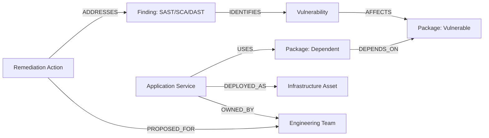

# PatchPilot Synthetic Benchmark Graph Dataset

> **LEGAL & SECURITY DISCLAIMER**  
> All entities, vulnerabilities, package names, applications, and infrastructure assets in this dataset are **100% synthetic** benchmarks created exclusively for evaluating graph-powered security triage agents in hackathons and testing environments. They do **not** represent verified real-world vulnerabilities, active zero-days, or production cloud environments.

---

## 1. Overview & Reproducibility Guarantee

This dataset is self-contained and version-controlled. It requires **no external downloads**, no Kaggle API keys, and no third-party network requests.

- **Primary Seed File**: [`graph_dataset.json`](./graph_dataset.json)
- **Ground Truth Test Fixtures**: [`ground_truth_test_cases.json`](./ground_truth_test_cases.json)
- **Database Engine**: FalkorDB (RedisGraph-compatible graph database)
- **Idempotency**: All graph ingestion queries utilize Cypher `MERGE` statements with parameterization. Repeated executions do not duplicate nodes or edges.

---

## 2. Graph Schema & Relationship Topology



### Node Types & Properties

| Label | Key Properties | Role & Validation Value |
| :--- | :--- | :--- |
| `Vulnerability` | `id`, `title`, `description`, `severity`, `cvss_score`, `cve`, `incomplete_evidence`, `is_synthetic` | CVE finding reference. `incomplete_evidence` tests uncertainty handling. |
| `Package` | `name`, `version`, `ecosystem`, `is_synthetic` | Software component in the dependency graph. Supports `npm` and `pip`. |
| `Application` | `id`, `name`, `environment`, `language`, `is_synthetic` | Microservice or workload. Can be production or staging. |
| `Asset` | `id`, `name`, `criticality`, `environment`, `region`, `exposed`, `is_synthetic` | Deployment target. `criticality` (CRITICAL, HIGH, MEDIUM, LOW) & `exposed` (true/false) drive priority calculation. |
| `Team` | `id`, `name`, `email`, `is_synthetic` | Code and operational ownership. Empty team ownership triggers missing evidence warnings. |
| `Finding` | `id`, `status`, `source`, `detected_at`, `incomplete_evidence`, `is_synthetic` | Scan report entry connecting security tools to vulnerabilities. |

### Dependency Traversal Direction

For package dependencies, `(:Package)-[:DEPENDS_ON]->(:Package)` models `Consumer -> Upstream Dependency`.
- When discovering blast radius from a vulnerable package, PatchPilot traverses the relationship in reverse:
  ```cypher
  MATCH (v:Vulnerability {id: $vid})-[:AFFECTS]->(vp:Package)
  MATCH path = (appPkg:Package)-[:DEPENDS_ON*0..4]->(vp)
  MATCH (app:Application)-[:USES]->(appPkg)
  RETURN app.name, path
  ```

---

## 3. Ground Truth Test Scenarios

The dataset is engineered with 4 mathematically and structurally verified benchmark cases:

### Scenario 1: Direct Package Dependency (`VULN-2024-001`)
- **Vulnerability**: Remote Code Execution in `xml-parser@2.4.1` (CRITICAL, CVSS 9.8).
- **Direct Downstream Dependents**:
  - `auth-middleware@1.3.0` directly imports `xml-parser`.
  - `http-client@5.0.0` directly imports `xml-parser`.
- **Directly Affected Applications**:
  - `Payment Gateway` (uses `auth-middleware@1.3.0`).
  - `User Portal` (uses `http-client@5.0.0`).
- **Expected Hop Count**: 1 package hop.

### Scenario 2: Deep Multi-Hop Transitive Dependency (`VULN-2024-001`)
- **Transitive Chain**:
  `xml-parser@2.4.1` $\leftarrow$ `http-client@5.0.0` $\leftarrow$ `data-processor@2.1.0` $\leftarrow$ `report-engine@4.0.0`
- **Affected Application**: `Report Generator` (uses `report-engine@4.0.0`).
- **Expected Hop Count**: 3 hops against `DEPENDS_ON`.
- **Expected Verification**: Confirms that non-obvious transitive packages in deep microservice dependency trees are surfaced.

### Scenario 3: Multiple Affected Assets & Public Internet Exposure (`VULN-2024-001`)
- **Applications Impacted**: `Payment Gateway`, `User Portal`, `Report Generator`.
- **Assets Impacted**:
  1. `asset-prod-k8s` (`Production Kubernetes Cluster`): CRITICAL criticality, **internet-exposed** (`exposed: true`).
  2. `asset-payments-db` (`Payments Database`): CRITICAL criticality, internal (`exposed: false`).
  3. `asset-batch-server` (`Batch Report Server`): MEDIUM criticality, internal.
- **Expected Priority Score**: **89.2 / 100 (CRITICAL)**.
  - Severity Weight: 40.0
  - Highest Asset Criticality: 30.0
  - Internet Exposure Bonus: 10.0
  - Reach Score (3 apps): 9.2
  - Confidence Penalty: 0.0

### Scenario 4: Insufficient Evidence & Missing Ownership Handling (`VULN-2024-004`)
- **Vulnerability**: Path Traversal in `file-utils@3.1.2` (HIGH, CVSS 7.5).
- **Incomplete Evidence Flag**: `incomplete_evidence: true` on both Vulnerability and Finding nodes.
- **Missing Ownership**: `Report Generator` application has `team_id: null` (unassigned ownership).
- **Expected Prioritization Behavior**:
  - Confidence Penalty: **-15.0 pts**.
  - Missing Evidence Warning: "Vulnerability evidence is marked as incomplete" and "One or more affected applications have no assigned responsible team".
  - Priority Label: **UNCERTAIN** (or down-weighted score).
  - Triage Explanation: Clearly states that missing facts prevent definitive low-risk assumptions.

---

## 4. Resetting and Reseeding FalkorDB

The seed process is completely reproducible and can be run at any time through 3 methods.

### Method A: Standalone CLI Script (Recommended)

```bash
# Navigate to the backend directory
cd patchpilot/backend

# Reset the graph and reseed from scratch:
./venv/bin/python ../scripts/seed_graph.py --clear

# Reseed without clearing (idempotent MERGE):
./venv/bin/python ../scripts/seed_graph.py

# Reseed using a specific custom dataset file:
./venv/bin/python ../scripts/seed_graph.py --file ../data/synthetic_data/graph_dataset.json --clear
```

### Method B: REST API Endpoint

While the backend is running (`uvicorn app.main:app`):

```bash
# Idempotent reseed (preserves existing remediations/investigations):
curl -X POST http://localhost:8000/api/seed

# Complete fresh reset and reseed (wipes existing nodes):
curl -X POST "http://localhost:8000/api/seed?clear_first=true"
```

### Method C: Web UI One-Click Reseed

1. Open the PatchPilot web console at `http://localhost:5173`.
2. Navigate to **System Status** (`/status`).
3. Click **Seed Synthetic Data** or **Reset & Reseed Graph**.

### Method D: Raw Cypher Verification via redis-cli

If inspecting FalkorDB directly:

```bash
# Clear graph:
redis-cli GRAPH.QUERY patchpilot "MATCH (n) DETACH DELETE n"

# Verify node counts:
redis-cli GRAPH.QUERY patchpilot "MATCH (v:Vulnerability) RETURN count(v)"
redis-cli GRAPH.QUERY patchpilot "MATCH (p:Package) RETURN count(p)"
redis-cli GRAPH.QUERY patchpilot "MATCH (a:Application) RETURN count(a)"
redis-cli GRAPH.QUERY patchpilot "MATCH (s:Asset) RETURN count(s)"
redis-cli GRAPH.QUERY patchpilot "MATCH (t:Team) RETURN count(t)"
```
