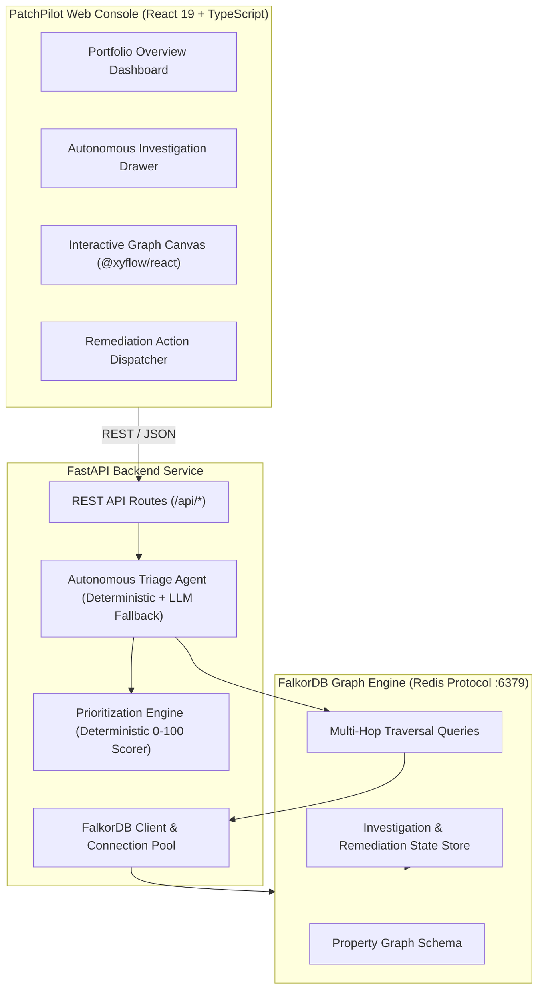
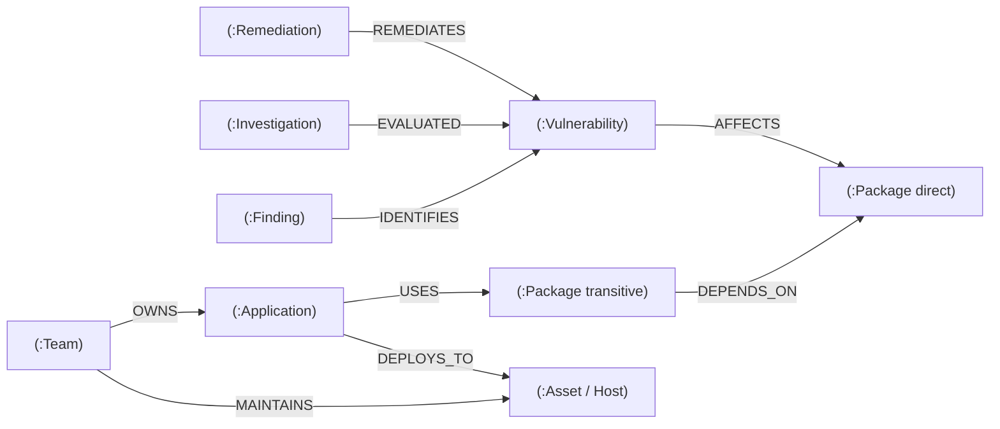

# 🏛️ PatchPilot Architecture & Technical Specification

> **PatchPilot: Graph-Powered Vulnerability Triage and Remediation Agent**  
> WeMakeDevs Graph Hacks — Track 01: Agents That Act on Connected Data  
> Primary Graph Engine: **FalkorDB** | Backend: **FastAPI / Python** | Frontend: **React 19 / TypeScript**

---

## 1. System Overview

Modern enterprise vulnerability management fails due to context isolation. Vulnerability scanners output thousands of CVEs with base CVSS scores, but lack runtime context:
- Is the vulnerable library actually in the runtime dependency path or merely a dormant test dependency?
- How many transitive dependency hops separate our customer-facing applications from the vulnerability?
- What physical or cloud infrastructure assets host the affected application, and are they exposed to the public internet?
- Which engineering team owns the service, and what is their on-call escalation channel?

PatchPilot solves this context gap by modeling enterprise software security as an active **Property Graph in FalkorDB**. PatchPilot’s autonomous triage agent navigates multi-hop relationship chains in real-time, executing Cypher queries to compute deterministic, evidence-backed priority scores and propose actionable remediations.



---

## 2. Graph Schema & Node Typology

PatchPilot enforces a strict graph schema within FalkorDB. All nodes and edges reflect real-world software supply chain and infrastructure relationships.



### 2.1 Node Definitions

| Node Label | Key Properties | Types | Description |
| :--- | :--- | :--- | :--- |
| `Vulnerability` | `id`, `cve_id`, `title`, `severity`, `cvss_score`, `epss_score`, `has_exploit`, `description`, `patch_version`, `is_synthetic` | String, Float, Boolean | Security vulnerability record or synthetic benchmark CVE. |
| `Package` | `id`, `name`, `version`, `ecosystem` | String | Software package in the dependency tree (npm, maven, pypi, go). |
| `Application` | `id`, `name`, `repo_url`, `language`, `tier` | String | Enterprise service or microservice consuming packages. |
| `Asset` | `id`, `name`, `type`, `environment`, `exposure`, `criticality` | String | Compute or runtime host (`production`, `staging`, `internal`; `public` vs `internal`; `CRITICAL`, `HIGH`, `MEDIUM`, `LOW`). |
| `Team` | `id`, `name`, `email`, `slack_channel`, `on_call` | String | Engineering team owning services and infrastructure. |
| `Finding` | `id`, `scanner`, `first_seen`, `status` | String | Security scanner detection occurrence. |
| `Investigation` | `id`, `vuln_id`, `score`, `priority_label`, `completed_at`, `status` | String, Float | Audit record of an agent triage run. |
| `Remediation` | `id`, `action_type`, `status`, `target_package`, `recommended_version`, `created_at` | String | Remediation lifecycle item proposed and tracked by SecOps. |

### 2.2 Relationship Semantics & Directionality

Proper edge directionality is essential for accurate graph traversals:

1. `(:Vulnerability)-[:AFFECTS]->(:Package)`  
   The vulnerability directly impacts a specific package version.
2. `(:Package)-[:DEPENDS_ON]->(:Package)`  
   **Crucial Directionality**: If Package A depends on Package B, the relationship is stored as `(A)-[:DEPENDS_ON]->(B)`. When discovering dependents of a vulnerable package `V -> B`, the engine queries incoming edges `(A)-[:DEPENDS_ON*]->(B)`.
3. `(:Application)-[:USES]->(:Package)`  
   An application directly consumes or imports a package.
4. `(:Application)-[:DEPLOYS_TO]->(:Asset)`  
   An application is deployed onto a cloud asset or runtime container.
5. `(:Team)-[:OWNS]->(:Application)`  
   Engineering team possessing code ownership of the microservice.
6. `(:Team)-[:MAINTAINS]->(:Asset)`  
   Infrastructure / DevOps team maintaining the runtime deployment.
7. `(:Remediation)-[:REMEDIATES]->(:Vulnerability)`  
   A proposed or approved corrective action addressing a vulnerability.
8. `(:Investigation)-[:EVALUATED]->(:Vulnerability)`  
   Historical agent investigation linked to its evaluated vulnerability.

---

## 3. Cypher Query Catalog

PatchPilot relies on native Cypher queries executed directly against FalkorDB. The queries discover multi-hop blast radius, compute impact paths, and retrieve ownership without in-memory Python graph processing.

### 3.1 Multi-Hop Transitive Dependency & Blast Radius

Discovers all applications affected by a vulnerability, whether directly or through multiple transitive dependency hops:

```cypher
MATCH (v:Vulnerability {id: $vuln_id})-[:AFFECTS]->(vuln_pkg:Package)
OPTIONAL MATCH (app:Application)-[:USES]->(direct_pkg:Package)
WHERE direct_pkg = vuln_pkg
OPTIONAL MATCH (app_trans:Application)-[:USES]->(dep_pkg:Package)-[:DEPENDS_ON*1..5]->(vuln_pkg)
WITH v, vuln_pkg,
     collect(DISTINCT app) + collect(DISTINCT app_trans) AS apps
UNWIND (CASE WHEN size(apps) = 0 THEN [null] ELSE apps END) AS app
OPTIONAL MATCH (app)-[:DEPLOYS_TO]->(asset:Asset)
OPTIONAL MATCH (team:Team)-[:OWNS]->(app)
RETURN v.id AS vuln_id,
       v.severity AS severity,
       vuln_pkg.name AS package_name,
       vuln_pkg.version AS package_version,
       app.name AS application_name,
       asset.name AS asset_name,
       asset.criticality AS asset_criticality,
       asset.exposure AS asset_exposure,
       team.name AS team_name,
       team.email AS team_email,
       team.slack_channel AS team_slack
```

### 3.2 Full Subgraph Evidence Retrieval

Builds the node and edge sets required to render interactive visualizations in the UI canvas:

```cypher
MATCH (v:Vulnerability {id: $vuln_id})
OPTIONAL MATCH (v)-[r1:AFFECTS]->(p1:Package)
OPTIONAL MATCH (p2:Package)-[r2:DEPENDS_ON*1..5]->(p1)
OPTIONAL MATCH (app:Application)-[r3:USES]->(p)
WHERE p = p1 OR p = p2
OPTIONAL MATCH (app)-[r4:DEPLOYS_TO]->(asset:Asset)
OPTIONAL MATCH (team:Team)-[r5:OWNS]->(app)
RETURN v, p1, p2, app, asset, team, r1, r3, r4, r5
```

### 3.3 Asset & Criticality Rollup

Aggregates the highest asset criticality and counts distinct runtime environments for a vulnerability:

```cypher
MATCH (v:Vulnerability {id: $vuln_id})-[:AFFECTS]->(p:Package)
OPTIONAL MATCH (app:Application)-[:USES]->(:Package)-[:DEPENDS_ON*0..5]->(p)
OPTIONAL MATCH (app)-[:DEPLOYS_TO]->(asset:Asset)
RETURN count(DISTINCT app) AS affected_app_count,
       count(DISTINCT asset) AS affected_asset_count,
       collect(DISTINCT asset.criticality) AS criticalities,
       collect(DISTINCT asset.exposure) AS exposures
```

---

## 4. Deterministic Prioritization Formula

PatchPilot rejects black-box scoring. Its prioritization engine uses a documented, 100% deterministic mathematical model that combines vulnerability metrics, runtime blast radius, asset exposure, and evidence completeness.

$$\text{Final Score} = \max\left(0, \min\left(100, S_{\text{sev}} + S_{\text{crit}} + S_{\text{reach}} + S_{\text{exp}} + P_{\text{conf}}\right)\right)$$

### 4.1 Component Breakdown

1. **Vulnerability Severity ($S_{\text{sev}}$)**:
   - `CRITICAL`: 40.0 pts
   - `HIGH`: 30.0 pts
   - `MEDIUM`: 18.0 pts
   - `LOW`: 8.0 pts
   - `INFORMATIONAL`: 2.0 pts

2. **Asset Criticality ($S_{\text{crit}}$)** (determined by the highest-criticality affected asset):
   - `CRITICAL`: 30.0 pts
   - `HIGH`: 22.0 pts
   - `MEDIUM`: 14.0 pts
   - `LOW`: 6.0 pts
   - *No assets linked*: 0.0 pts

3. **Reach Score ($S_{\text{reach}}$)** (logarithmic scaling based on count of affected applications):
   $$S_{\text{reach}} = \min\left(20.0, 20.0 \times \frac{\ln(N_{\text{apps}} + 1)}{\ln(11)}\right)$$
   - 1 application: 5.9 pts
   - 2 applications: 9.2 pts
   - 3 applications: 11.6 pts
   - 5 applications: 14.9 pts
   - 10+ applications: 20.0 pts

4. **Exposure Bonus ($S_{\text{exp}}$)**:
   - $+10.0$ pts if any affected asset has `exposure: "public"` (internet-facing).
   - $0.0$ pts if internal or isolated.

5. **Evidence Completeness Penalty ($P_{\text{conf}}$)**:
   - $-15.0$ pts if evidence is flagged incomplete (missing SBOM records, unknown reachability, unverified assets).

### 4.2 Priority Classification Bands

| Score Range | Priority Label | SLA / Recommended Action |
| :--- | :--- | :--- |
| **75.0 – 100.0** | `CRITICAL` | Immediate patch/mitigation required. Escalate to team on-call within 24 hours. |
| **55.0 – 74.9** | `HIGH` | Patch or upgrade within 7 days. Notify responsible team and track remediation. |
| **35.0 – 54.9** | `MEDIUM` | Schedule remediation in next planned sprint. Monitor for exploitation indicators. |
| **0.0 – 34.9** | `LOW` | Remediate in next routine release cycle. Document and monitor. |
| *Special Case* | `UNCERTAIN` | Assigned when evidence is incomplete and score falls below 40.0; prompts manual evidence verification before deprioritizing. |

---

## 5. Autonomous Agent Architecture

The PatchPilot agent combines graph navigation with explainable rationale generation:

```
[Finding Ingestion] ➔ [Graph Traversal] ➔ [Blast Radius Evaluation] ➔ [Deterministic Scoring] ➔ [Remediation Formulation] ➔ [Graph Persistence]
```

1. **Step 1: Graph Traversal**: Queries FalkorDB to discover all affected packages, direct and transitive dependencies, downstream applications, and cloud assets.
2. **Step 2: Ownership Resolution**: Identifies code owners and infrastructure teams (`(:Team)` nodes) responsible for the affected services.
3. **Step 3: Deterministic Scoring**: Computes the exact 0–100 priority score using the verified mathematical formula.
4. **Step 4: Rationale Synthesis**: Formulates a clear, human-readable justification referencing actual graph paths and asset criticality. (If an LLM API key like OpenAI/Anthropic is present, it generates enhanced natural language commentary; otherwise, it falls back to a deterministic template reasoner without inventing facts).
5. **Step 5: Remediation Proposal**: Creates a safe remediation action (`UPGRADE`, `PATCH`, `WAF_RULE`, `ISOLATE`) targeting the verified safe version.
6. **Step 6: Graph Persistence**: Writes an `(:Investigation)` node into FalkorDB and creates an `[:EVALUATED]` relationship to the vulnerability for audit tracking.

---

## 6. Synthetic Benchmark Dataset

To ensure 100% reproducible testing and evaluation without relying on third-party APIs or external Kaggle downloads:
- **Location**: `patchpilot/data/synthetic_data/graph_dataset.json`
- **Ground Truth**: `patchpilot/data/synthetic_data/ground_truth_test_cases.json`
- **Labeling**: Every synthetic node carries `is_synthetic: true` and a `[SYNTHETIC BENCHMARK]` banner in the UI to maintain absolute scientific integrity.
- **Test Scenarios**: Includes direct dependency impacts, deep 3-hop transitive chains (`spring-boot-starter-log4j2` -> `log4j-core`), multi-application shared dependencies (`auth-lib`), and intentionally incomplete evidence chains (`VULN-INCOMPLETE-001`).

---

## 7. Fault Tolerance & Degraded Mode

PatchPilot is architected to be resilient:
- If FalkorDB is offline or unreachable at startup, the backend does not crash. It starts up, logs a descriptive warning, and reports `"status": "degraded"` on `/api/health`.
- Unit tests (`TestPrioritizationEngine`) execute with zero database dependency (13/13 passing in isolation).
- Graph queries automatically handle missing relationships using Cypher `OPTIONAL MATCH`, preventing null pointer exceptions during traversals.
