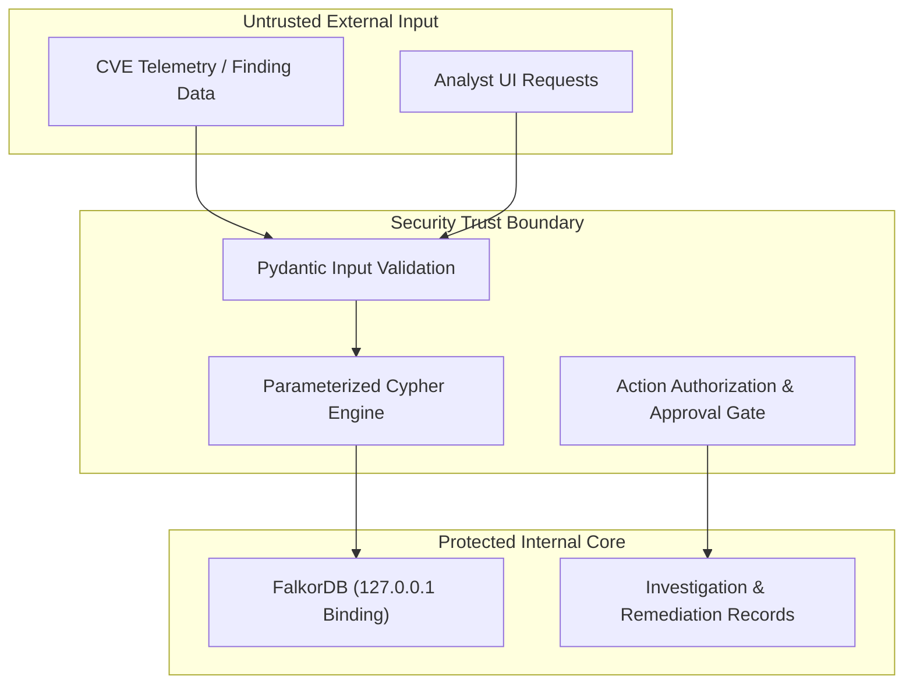

# 🛡️ PatchPilot Security Policy & Threat Model

> **PatchPilot**: Graph-Powered Vulnerability Triage and Remediation Agent  
> Document Version: 1.0.0 | Security Baseline for WeMakeDevs Graph Hacks

---

## 1. Threat Model & Security Boundaries

PatchPilot is designed as an internal security engineering platform that connects vulnerability telemetry with application infrastructure and code ownership. Because security tools can themselves become high-value targets, PatchPilot implements defensive boundaries at every layer.



---

## 2. Parameterized Cypher & Query Security

### 2.1 Cypher Injection Prevention
Like SQL injection, Cypher injection occurs when untrusted user input is concatenated directly into query strings. PatchPilot strictly forbids dynamic query string interpolation for user-supplied IDs.

**Secure Implementation Standard**:
```python
# SECURE: Always pass user input via FalkorDB parameters
query = "MATCH (v:Vulnerability {id: $vuln_id}) RETURN v"
params = {"vuln_id": user_supplied_vuln_id}
graph.query(query, params)
```

**Forbidden Pattern**:
```python
# INSECURE: Never interpolate raw parameters into Cypher
# query = f"MATCH (v:Vulnerability {{id: '{user_supplied_vuln_id}'}}) RETURN v"  <-- VIOLATION
```

All Cypher queries in `app/graph/queries.py` adhere to parameterized execution.

---

## 3. Safe Remediation Boundaries & Human-in-the-Loop

A core principle of PatchPilot is **never perform unverified automated mutating actions on production environments**.

### 3.1 Simulated Actions vs Autonomous Execution
1. **Remediation Proposals**: The PatchPilot agent generates *structured remediation proposals* (e.g. `UPGRADE_PACKAGE`, `WAF_RULE`, `ISOLATE_ASSET`) based on graph evidence.
2. **Human Approval Gate**: Every remediation record requires explicit operator review in the UI before its status advances from `PROPOSED` to `APPROVED`.
3. **No Unauthenticated Remote Code Execution**: PatchPilot does not execute arbitrary shell commands or SSH into cloud hosts. Remediation actions are logged as tracked tickets in FalkorDB and routed to the verified on-call owner's Slack/Email channel.

---

## 4. Secret & Credential Management

### 4.1 Zero-Secret Repository Guarantee
- No production API keys, database passwords, or private keys are committed to source control.
- Git tracking is protected by comprehensive `.gitignore` rules that block:
  - `.env`, `.env.*` (excluding `.env.example`)
  - `*.pem`, `*.key`, `id_rsa*`
  - `falkordb_data/`, `node_modules/`, `venv/`
  - Database dumps and logs

### 4.2 Safe Configuration Templates
Repository templates (`.env.example`) provide placeholder configuration without default secret values:
```bash
FALKORDB_HOST=127.0.0.1
FALKORDB_PORT=6379
FALKORDB_PASSWORD=
LLM_PROVIDER=deterministic
OPENAI_API_KEY=
```
If LLM API keys are omitted, the application seamlessly defaults to the deterministic local reasoner without failing.

---

## 5. Network & Database Isolation

1. **Localhost Binding**: In `docker-compose.yml`, FalkorDB is bound strictly to `127.0.0.1:6379:6379` rather than `0.0.0.0:6379`. This prevents accidental external exposure on public container host interfaces.
2. **CORS Restrictions**: The FastAPI backend restricts Cross-Origin Resource Sharing (`CORS_ORIGINS`) to designated development origins (`http://localhost:5173`, `http://localhost:3000`).
3. **Database Degraded Mode**: If FalkorDB is unreachable, the backend reports `"status": "degraded"` rather than leaking internal database stack traces or connection strings.

---

## 6. Synthetic Benchmark & Data Integrity

To maintain scientific integrity during hackathon evaluation:
- All synthetic test findings carry the explicit flag `is_synthetic: true`.
- Synthetic CVEs are prominently marked with `[SYNTHETIC BENCHMARK]` badges in the UI.
- PatchPilot never represents synthetic findings as verified real-world vulnerabilities or exploits.
- The ground truth test cases are stored in version control (`data/synthetic_data/ground_truth_test_cases.json`) to allow full reproducibility of scoring and blast-radius results.

---

## 7. Reporting a Vulnerability

If you discover a security vulnerability in PatchPilot:
1. Please do **not** open a public GitHub issue.
2. Contact the maintainers directly via email: `security@patchpilot.internal` (or repository author contact).
3. Provide a detailed summary, reproduction steps, and proof of concept.
4. Maintainers will acknowledge receipt within 48 hours and work with you on a responsible disclosure timeline.
